<div align="center">


<br />

[](https://github.com/vinycius11dev/safewalk/actions/workflows/release.yml)


**[Abrir o app](https://safewalk.recapture.com.br/app)** · **[Apresentação](https://safewalk.recapture.com.br/proposta/)** · **[Painel da Prefeitura](https://painel.safewalk.recapture.com.br)** · **[Vídeo](#-vídeo)**

Global Solution FIAP 2026.2 · CitizenTech · Engenharia de Software, 3º ano

</div>

---

## Sumário

- [Sobre o projeto](#-sobre-o-projeto)
- [Ficha da CitizenTech](#-ficha-da-citizentech)
- [Equipe](#-equipe)
- [Vídeo](#-vídeo)
- [Telas do app](#-telas-do-app)
- [Entrega de Mobile Development & IoT](#-entrega-de-mobile-development--iot)
- [Arquitetura](#-arquitetura)
- [Banco de dados](#-banco-de-dados)
- [Identidade visual](#-identidade-visual)
- [Como rodar](#-como-rodar)
- [Qualidade e publicação](#-qualidade-e-publicação)
- [Documentação](#-documentação)

## 🚶 Sobre o projeto

Quem volta a pé sozinho, principalmente à noite, não sabe o que vai encontrar no caminho. Pode ter rua escura, buraco, alagamento ou calçada ruim, e se algo acontecer, ninguém de confiança fica sabendo a tempo.

O **SafeWalk** é um aplicativo Expo/React Native para quem anda a pé por São Paulo:

- **Planeja a rota a pé** e mostra o que já foi registrado no caminho, com dados públicos da cidade: iluminação, semáforos, calçadas, alagamentos, solicitações SP156 e chuva.
- **Avisa contatos de confiança.** Eles recebem um link com o roteiro e a última posição recebida.
- **Protege durante o trajeto** com SOS, check-in quando a pessoa passa do horário, alerta por perda de sinal e PIN de coação.
- **Leva os problemas da rua à Prefeitura.** O cidadão relata e escolhe se envia ao painel municipal.

> O app mostra registros públicos e o que as pessoas relataram. Ele **não certifica** que um caminho é seguro ou acessível.

## 📋 Ficha da CitizenTech

| Campo                      | Resposta                                                                                                                                                                                                                               |
| -------------------------- | -------------------------------------------------------------------------------------------------------------------------------------------------------------------------------------------------------------------------------------- |
| **Nome**                   | SafeWalk                                                                                                                                                                                                                               |
| **Cidade e bairro**        | São Paulo (SP). Piloto na Bela Vista e no entorno da Avenida Paulista, onde fica a FIAP Paulista.                                                                                                                                      |
| **Cidadão beneficiado**    | Quem anda a pé sozinho, principalmente à noite: estudantes saindo da faculdade, trabalhadores, idosos e pessoas com deficiência ou mobilidade reduzida.                                                                                |
| **Problema, em uma frase** | Quem volta a pé sozinho não sabe o que vai encontrar no caminho e, se algo acontecer, ninguém de confiança fica sabendo a tempo.                                                                                                       |
| **Como funciona**          | A pessoa busca o destino, compara rotas a pé com os registros públicos do trajeto, escolhe quem acompanha e inicia a caminhada. Se não confirmar a chegada, o app pede um check-in e mostra o alerta a quem acompanha.                 |
| **O que cada parte faz**   | **App** (`apps/mobile`): jornada do cidadão. **API** (`apps/api`): regras, contas, dados urbanos e alertas. **Banco** (`database`): MariaDB no servidor e SQLite no aparelho. **Painel** (`apps/admin`): relatos para a Prefeitura.    |
| **Link do repositório**    | https://github.com/vinycius11dev/safewalk                                                                                                                                                                                              |
| **Indicador de impacto**   | Percentual de caminhadas encerradas com "Cheguei bem"; tempo entre um alerta e a visualização pelo contato; relatos de zeladoria enviados e resolvidos pela Prefeitura.                                                                |
| **ODS conectados**         | **11** (11.2 e 11.7): deslocamento a pé e espaços públicos mais seguros. **10** (10.2): perfil Idoso/PCD e rota para cadeirante. **3** (3.6): sinistros e semáforos no percurso. **13** (13.1): alerta de chuva e áreas de alagamento. |

## 👥 Equipe

| Integrante       |     RM |
| ---------------- | -----: |
| Enzo Dias        | 558225 |
| Gabriel Dias     | 556830 |
| Gabriel Galerani | 557421 |
| Gustavo Alves    | 557876 |
| Leonardo Taschin | 554583 |

## 🎬 Vídeo

**Vídeo de até 3 minutos com o app rodando:** _cole aqui o link do YouTube_

O roteiro está em [docs/video-mobile.md](docs/video-mobile.md).

## 📱 Telas do app

|                                            Boas-vindas                                            |                                        Cadastro                                         |                                                 Início                                                  |                                                   Buscar                                                   |                                                   Recentes                                                   |
| :-----------------------------------------------------------------------------------------------: | :-------------------------------------------------------------------------------------: | :-----------------------------------------------------------------------------------------------------: | :--------------------------------------------------------------------------------------------------------: | :----------------------------------------------------------------------------------------------------------: |
|          |     | 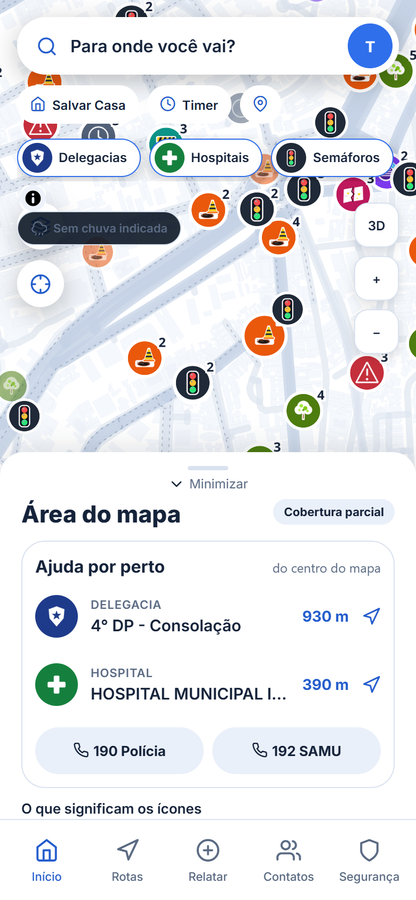 | 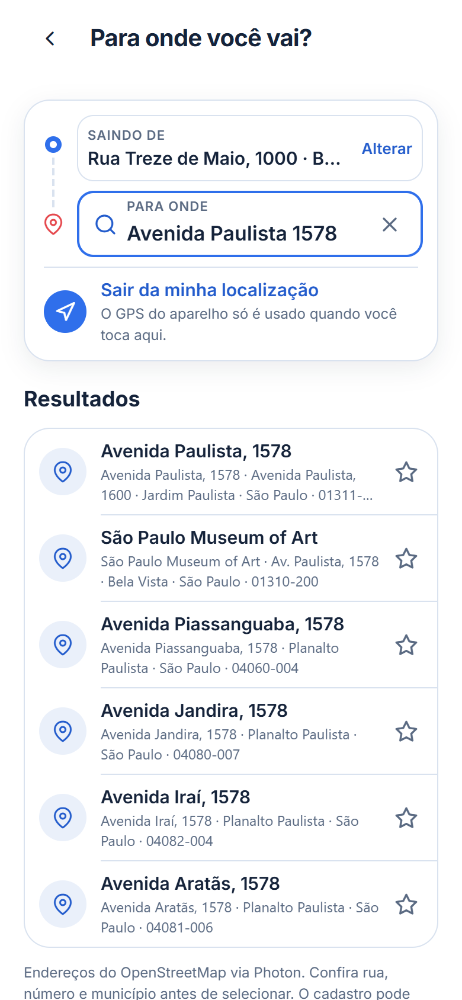 |  |
|                                        **Comparar rotas**                                         |                                      **Caminhada**                                      |                                               **Relatar**                                               |                                                **Contatos**                                                |                                                  **Perfil**                                                  |
| 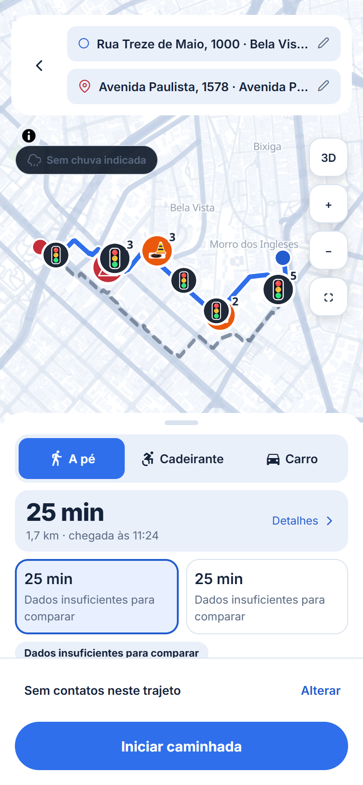 | 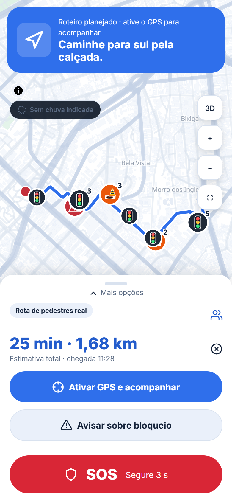 |        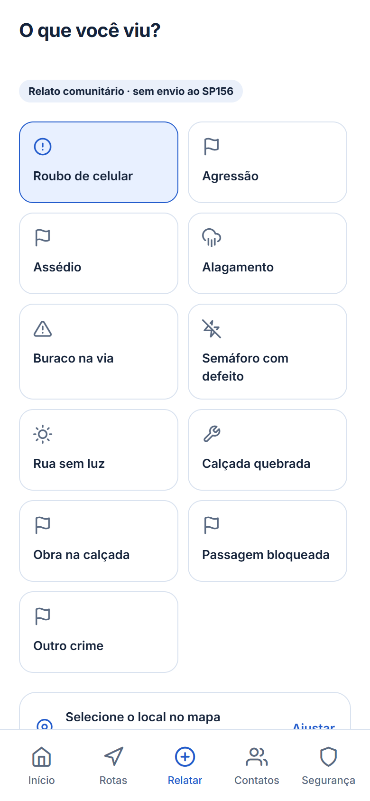        |                    |  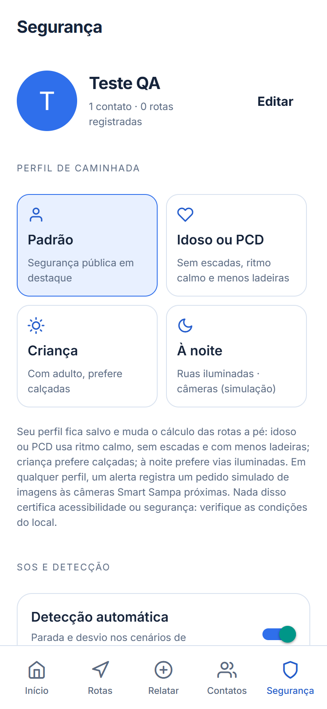  |

<sub>Prints do app em tamanho de celular (390 × 844), com contas fictícias de teste. Toque em uma imagem para ver em tamanho real.</sub>

### Jornada principal do cidadão

1. **Cria a conta** e vê as permissões. O GPS é opcional e só liga quando a pessoa toca no botão.
2. **Cadastra o PIN** e o primeiro contato de confiança.
3. **Busca o destino** em endereços reais de São Paulo e **compara as rotas a pé**. Os últimos destinos ficam salvos no aparelho.
4. **Escolhe quem acompanha** e inicia a caminhada. O contato recebe o link de acompanhamento.
5. **Durante o trajeto** tem SOS (segurar 3 s), aviso de bloqueio e "Cheguei ao destino". Encerrar exige o PIN.
6. **Relata um problema da rua**, como buraco, rua sem luz ou alagamento, e escolhe se envia ao painel da Prefeitura.

## ✅ Entrega de Mobile Development & IoT

| Critério                  | Como o SafeWalk atende                                                                                                                                                                                                                           |
| ------------------------- | ------------------------------------------------------------------------------------------------------------------------------------------------------------------------------------------------------------------------------------------------ |
| **Telas e navegação**     | Expo Router com rotas em arquivo (`apps/mobile/src/app`): 5 abas (Início, Rotas, Relatar, Contatos, Segurança), telas empilhadas e rotas dinâmicas como `trajeto/[id]` e `acompanhar/[token]`.                                                   |
| **Consumo de dados**      | API REST própria, consumida com TanStack Query (cache, carregamento e erro em todas as telas). A API consulta GeoSampa, SP156, Open-Meteo, CGE, Photon (endereços) e Valhalla (rotas a pé). Respostas validadas com zod.                         |
| **Banco de dados**        | **No servidor:** MariaDB com 24 migrações versionadas. **No aparelho:** SQLite (`expo-sqlite`) com os destinos recentes, que aparecem mesmo sem internet, e a sessão no `expo-secure-store`. Detalhes em [Banco de dados](#-banco-de-dados).     |
| **Acessibilidade**        | Rótulos, papéis e estados para leitor de tela em todos os controles, avisos falados (`accessibilityLiveRegion`), tema claro e escuro, "reduzir movimento", áreas de toque de 44 px ou mais, perfil Idoso/PCD e rota para cadeirante sem escadas. |
| **Aderência ao problema** | Toda a jornada sai do problema da Ficha: rota a pé com os registros do trajeto, contato de confiança acompanhando, SOS e relato à Prefeitura. Nenhum dado pessoal real é usado.                                                                  |
| **Documentação**          | Este README (Ficha, equipe, prints, como rodar), [detalhes técnicos](docs/detalhes-tecnicos.md), [arquitetura](docs/architecture.md), [roteiro do vídeo](docs/video-mobile.md) e [prompts de IA](prompts.md).                                    |

## 🧭 Arquitetura

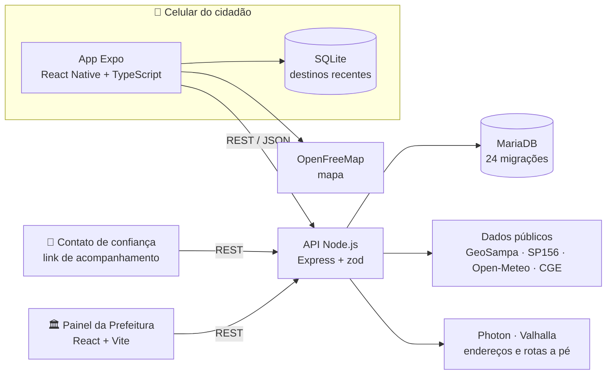

| Pasta                | O que tem                                                                                              |
| -------------------- | ------------------------------------------------------------------------------------------------------ |
| `apps/mobile`        | App Expo. `src/app` tem só as rotas; telas, hooks e serviços ficam em `src/features/<funcionalidade>`. |
| `apps/api`           | API Node/TypeScript: rota HTTP → service → repository → banco.                                         |
| `apps/admin`         | Painel da Prefeitura (React + Vite).                                                                   |
| `packages/contracts` | Schemas zod compartilhados entre app, API e painel.                                                    |
| `database`           | Migrações SQL do MariaDB.                                                                              |
| `docs`               | Decisões, fontes de dados, publicação, prints e imagens deste README.                                  |

## 🗄️ Banco de dados

O SafeWalk usa dois bancos, cada um com seu papel:

| Onde                   | Banco                  | O que guarda                                                                                                                                                     |
| ---------------------- | ---------------------- | ---------------------------------------------------------------------------------------------------------------------------------------------------------------- |
| **Servidor** (API)     | MariaDB, 26 tabelas    | Contas, PIN (hash), contatos e convites, trajetos, posições GPS, alertas, links de acompanhamento, relatos com foto, locais favoritos, cache dos dados públicos. |
| **Aparelho** (celular) | SQLite (`expo-sqlite`) | Os 8 últimos destinos escolhidos, separados por conta. Aparecem na busca na hora, mesmo sem internet.                                                            |

O banco local é criado e versionado pelo próprio app ([recent-destinations-store.ts](apps/mobile/src/features/places/recent-destinations-store.ts)):

```sql
CREATE TABLE recent_destinations (
  owner_id  TEXT NOT NULL,   -- conta dona do destino
  place_key TEXT NOT NULL,   -- ponto arredondado (~11 m): o mesmo lugar não se repete
  label     TEXT NOT NULL,
  latitude  REAL NOT NULL,
  longitude REAL NOT NULL,
  used_at   TEXT NOT NULL,   -- ISO 8601, UTC
  PRIMARY KEY (owner_id, place_key)
);
```

- **Gravar:** o destino entra por upsert e só os 8 mais recentes ficam, dentro de uma transação.
- **Ler:** os dados são validados com zod ao ler, e linhas corrompidas são descartadas.
- **Apagar:** dá para remover um destino ou limpar tudo pela tela.
- **Sair da conta:** sair ou excluir a conta apaga os destinos do aparelho.
- **Na web:** o SQLite exigiria cabeçalhos que bloqueiam o mapa, então os destinos ficam no `localStorage`, com as mesmas regras.

## 🎨 Identidade visual


O símbolo é um **S desenhado como um caminho**: começa num ponto âmbar (a saída) e termina num anel (o destino). As cores ficam centralizadas em [`apps/mobile/src/theme/tokens.ts`](apps/mobile/src/theme/tokens.ts) e o app usa as mesmas telas nos temas claro e escuro.

**Marca**

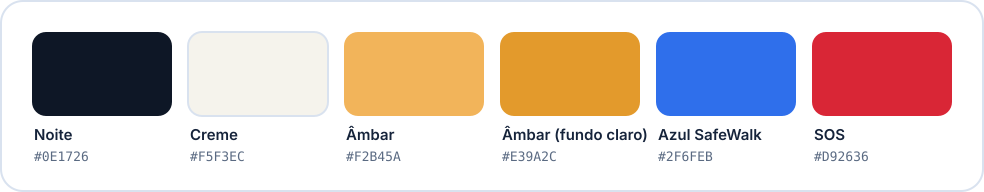

**Tema claro**

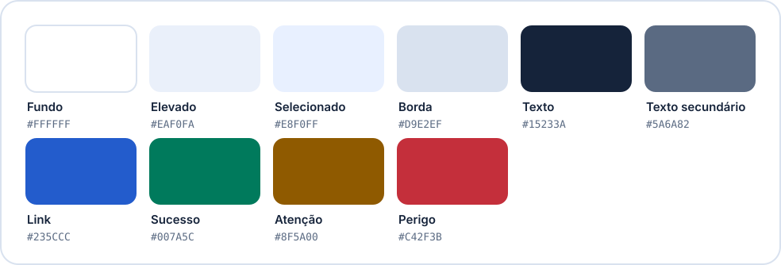

**Tema escuro**

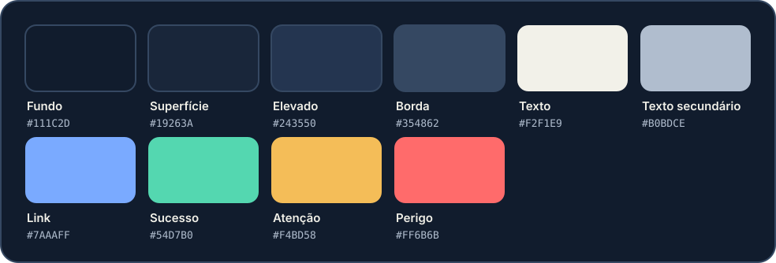

**Marcadores do mapa:** o símbolo é branco, e todos os fundos têm contraste de pelo menos 4,5:1 com o branco.

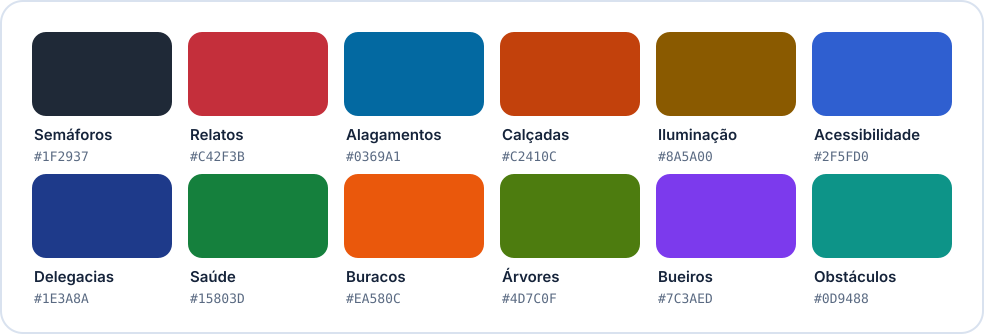

**Tipografia:** [Inter](https://fonts.google.com/specimen/Inter) nos pesos 400, 500, 600, 700 e 800, carregada com `@expo-google-fonts/inter`.

## 🚀 Como rodar

**Mais rápido:** abra **https://safewalk.recapture.com.br/app** no navegador do celular.

**No computador** (Node 22.13+, npm e MariaDB na porta 3307):

```bash
npm install
npm run db:setup     # cria o banco e o usuário local
npm run db:migrate   # aplica as 24 migrações
npm run dev          # API em http://localhost:4010 e app em http://localhost:8081
```

**No celular, pelo Expo:** coloque o IP do computador em `apps/mobile/.env`:

```bash
EXPO_PUBLIC_API_URL=http://<ip-do-computador>:4010
```

Depois rode:

```bash
npm run dev:mobile
```

O mapa nativo usa MapLibre, que não vem no Expo Go. Para ver o mapa no aparelho é preciso um development build (`npx expo run:android`). No Expo Go as outras telas funcionam e o mapa mostra esse aviso.

**Painel da Prefeitura:** `npm run dev:admin` abre em http://127.0.0.1:5190. Como criar o operador está em [detalhes técnicos](docs/detalhes-tecnicos.md#painel-da-prefeitura-demonstração).

## 🧪 Qualidade e publicação

```bash
npm run typecheck   # TypeScript strict em todos os pacotes
npm run lint
npm test            # testes da API, do painel e do app
```

Tudo que entra na `main` passa por typecheck, lint e testes no GitHub Actions. Se passar, vai sozinho para o servidor em até uns 10 minutos. O servidor busca a versão nova com uma chave somente leitura, então ninguém da equipe precisa de acesso à hospedagem. Como colaborar: [CONTRIBUTING.md](CONTRIBUTING.md).

**Dados com cuidado:**

- Nenhum dado pessoal real é usado. Os testes usam contas fictícias.
- Os dados urbanos são públicos, e o app mostra a fonte e a data de cada um.
- O GPS só é enviado durante um trajeto que a pessoa iniciou.

## 📚 Documentação

| Documento                                                                                                        | Assunto                                                              |
| ---------------------------------------------------------------------------------------------------------------- | -------------------------------------------------------------------- |
| [Detalhes técnicos](docs/detalhes-tecnicos.md)                                                                   | Fluxos, recursos de segurança, dados públicos, privacidade e limites |
| [Arquitetura](docs/architecture.md)                                                                              | Camadas, módulos e decisões                                          |
| [Cobertura de telas](docs/screen-coverage.md)                                                                    | Os 52 fluxos do protótipo                                            |
| [Dados urbanos](docs/urban-data.md), [busca e rotas](docs/routing-integration.md), [mapa](docs/map-rendering.md) | Fontes, importação e renderização                                    |
| [Hospedagem](docs/valuehost.md)                                                                                  | Publicação na ValueHost                                              |
| [Roteiro do vídeo](docs/video-mobile.md)                                                                         | Vídeo de 3 minutos da entrega de Mobile                              |
| [Prompts de IA](prompts.md)                                                                                      | Como a IA foi usada como copiloto                                    |

<div align="center">
<sub>SafeWalk · Global Solution FIAP 2026.2 · Engenharia de Software</sub>
</div>
